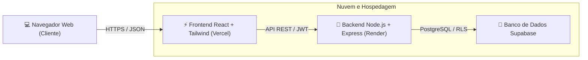

# 🎓 SUCELSO TECH | Sistema Inteligente de Horários Escolares
### **Universidade SENAI CIMATEC — Curso de Engenharia de Computação**
**Docente Responsável:** Prof. Celso Barreto  
**Disciplina / Desafio:** Situação de Aprendizagem — Arquitetura Full Stack (Supabase + Render + Vercel)

---

## 📌 Sumário Executivo
A escola fictícia **SUCELSO TECH**, voltada à formação tecnológica e profissional, enfrentava gargalos operacionais no planejamento de suas grades curriculares. O uso arcaico de planilhas causava duplicidade de salas, conflitos de agenda docente, dificuldades de atualização e morosidade na divulgação oficial.

O **SUCELSO TECH** foi concebido e implementado para resolver integralmente este cenário através de uma solução Full Stack moderna:
1. **Algoritmo Inteligente de Alocação (CSP + MRV + Heurística de Minimização de Janelas)**: Resolve conflitos automaticamente respeitando as restrições pedagógicas e as disponibilidades específicas dos professores.
2. **Controle Rigoroso de Perfis (RBAC)**: Alunos têm acesso estrito de leitura; professores gerenciam suas janelas de disponibilidade; e exclusivamente a coordenação homologa, edita e publica a versão oficial.
3. **Auditoria e Rastreabilidade Completa**: Histórico imutável de todas as modificações em formato JSONB.
4. **Diferenciais de Excelência**: Exportação de grades em PDF de alta qualidade, painel de taxa de ocupação dos laboratórios/salas em tempo real e redução de janelas ociosas entre aulas.

---

## 🏗️ Arquitetura Tecnológica



| Camada | Tecnologia | Plataforma de Hospedagem | Descrição |
| :--- | :--- | :--- | :--- |
| **Frontend** | React 18, Vite, Tailwind CSS, Lucide Icons | [Vercel](https://vercel.com) | Interface responsiva, interativa, com visualização semanal em blocos e exportação PDF. |
| **Backend** | Node.js, Express, JWT, Helmet, CORS | [Render](https://render.com) | API REST com validação de permissões RBAC e algoritmo inteligente CSP. |
| **Banco de Dados** | PostgreSQL 15 com RLS e Triggers | [Supabase](https://supabase.com) | Modelagem relacional, Row Level Security, chaves estrangeiras e integridade. |
| **Autenticação** | Supabase Auth / JWT Seguro | Supabase / Backend | Sessão segura com identificação de perfil no payload do token. |
| **Versionamento** | Git & GitHub | [ironJohnsson/Atv-SupaBase](https://github.com/ironJohnsson/Atv-SupaBase.git) | Código fonte modularizado e documentado. |

---

## 🛡️ Matriz de Permissões e Perfis de Acesso (RBAC)

> [!IMPORTANT]
> **Regra Fundamental:** Alunos possuem apenas permissão de leitura; professores modificam exclusivamente sua disponibilidade, não a grade oficial; somente coordenadores criam, ajustam, aprovam e publicam horários oficiais.

| Funcionalidade / Operação | Aluno | Professor | Coordenador |
| :--- | :---: | :---: | :---: |
| **Login e consulta de horários oficiais** | ✅ Sim | ✅ Sim | ✅ Sim |
| **Consulta de salas, disciplinas e turmas** | ✅ Sim | ✅ Sim | ✅ Sim |
| **Registro da própria disponibilidade** | ❌ Não | ✅ Sim | ✅ Sim |
| **Alteração da própria disponibilidade** | ❌ Não | ✅ Sim* | ✅ Sim |
| **Gerar proposta de grade automática** | ❌ Não | ❌ Não | ✅ Sim |
| **Aprovar, publicar e alterar horários oficiais** | ❌ Não | ❌ Não | ✅ Sim |
| **Cadastros acadêmicos (turmas, salas, disc)** | ❌ Não | ❌ Não | ✅ Sim |
| **Relatórios gerais, auditoria e conflitos** | ❌ Não | ❌ Não | ✅ Sim |

*\*Nota de Negócio:* Antes da homologação, a edição é livre no período de coleta. Após a publicação oficial da grade, qualquer mudança de disponibilidade registrada pelo professor é gravada como `pendente_aprovacao`, sem alterar automaticamente a grade oficial homologada pela coordenação.

---

## ⚙️ Endpoints da API REST Obrigatória

Todos os endpoints validam identidade via token JWT Bearer, perfil do usuário e entradas:

| Método | Endpoint | Perfil Autorizado | Finalidade |
| :---: | :--- | :---: | :--- |
| `GET` | `/api/horarios/minha-turma` | Aluno, Coord | Consultar grade horária oficial da turma |
| `GET` | `/api/horarios/professor` | Professor, Coord | Consultar horários de aula do docente |
| `GET` | `/api/disciplinas` | Todos | Listar disciplinas curriculares |
| `GET` | `/api/salas` | Todos | Listar salas e laboratórios |
| `POST` | `/api/disponibilidades` | Professor, Coord | Registrar nova janela de disponibilidade |
| `PUT` | `/api/disponibilidades/:id` | Professor, Coord | Atualizar janela de disponibilidade |
| `POST` | `/api/horarios/gerar` | Coordenador | Acionar algoritmo para gerar proposta de grade |
| `PUT` | `/api/horarios/:id` | Coordenador | Ajustar alocação manual de sala/docente/horário |
| `POST` | `/api/horarios/versoes/:id/publicar` | Coordenador | Homologar e oficializar versão da grade |
| `GET` | `/api/horarios/conflitos` | Todos / Coord | Diagnóstico em tempo real de choques de horário |
| `GET` | `/api/horarios/ocupacao-salas` | Coordenador | **Diferencial:** Análise de taxa de ocupação física |
| `GET` | `/api/horarios/historico` | Coordenador | Trilha de auditoria das alterações efetuadas |

---

## 🧪 Cenário Obrigatório de Validação (Item 10)

O sistema já vem pré-configurado com a massa de dados que atende estritamente a todos os requisitos de teste:
- **3 Turmas cadastradas**:
  1. *Engenharia de Computação - 5º Semestre* (Matutino)
  2. *Análise e Desenv. de Sistemas (ADS) - 3º Semestre* (Matutino)
  3. *Redes de Computadores - 2º Semestre* (Vespertino)
- **6 Professores cadastrados**:
  1. **Prof. Roberto Lima** (`roberto@sucelso.tech`) — **Restrição Estrita: Disponibilidade cadastrada APENAS às Segundas e Quartas-feiras**.
  2. Profa. Camila Duarte (`camila@sucelso.tech`)
  3. Prof. Marcos Vinicius (`marcos@sucelso.tech`)
  4. Profa. Juliana Santos (`juliana@sucelso.tech`)
  5. Prof. André Silveira (`andre@sucelso.tech`)
  6. Profa. Fernanda Rocha (`fernanda@sucelso.tech`)
- **8 Disciplinas**: Banco de Dados Avançado (BD01), Desenvolvimento Web Full Stack (DW02), Redes (RC03), Inteligência Artificial (IA04), Sistemas Distribuídos (SD05), Engenharia de Software (ES06), Segurança da Informação (SI07) e Projeto Integrador (PI08).
- **5 Salas**: Lab. Computação 101, Lab. Redes & Hardware 102, Lab. Inteligência Artificial 103, Sala de Aula Teórica 201 e Sala Maker 202.

---

## 🔑 Credenciais de Teste para a Banca Avaliadora

Para facilitar a validação durante a apresentação, a tela de login possui botões de **Acesso Rápido com 1 Clique**, ou podem ser digitadas manualmente:

| Perfil | E-mail de Teste | Senha Padrão | Cenário Demonstrado |
| :--- | :--- | :---: | :--- |
| **👔 Coordenador** | `coordenador@sucelso.tech` | `senha123` | Geração inteligente de grade, ajuste de slots, publicação oficial e auditoria. |
| **👨‍🏫 Professor** | `roberto@sucelso.tech` | `senha123` | **Restrição Seg/Qua**: Visualiza suas aulas e submete disponibilidade sem impactar a grade oficial. |
| **🎓 Aluno** | `lucas.aluno@sucelso.tech` | `senha123` | Visualização exclusiva da grade de Eng. Computação em modo somente leitura com exportação PDF. |

---

## 🚀 Como Executar Localmente

### Pré-requisitos
- Node.js v18 ou superior instalado
- Git

### 1. Clonar o Repositório
```bash
git clone https://github.com/ironJohnsson/Atv-SupaBase.git
cd Atv-SupaBase
```

### 2. Instalar Dependências
```bash
# Na raiz do projeto:
npm run install:all
```

### 3. Iniciar o Backend
```bash
cd backend
npm run dev
# O servidor iniciará em http://localhost:5000
```

### 4. Iniciar o Frontend
Em outro terminal:
```bash
cd frontend
npm run dev
# A aplicação estará disponível em http://localhost:5173
```

---

## 📂 Estrutura de Diretórios do Projeto

```
Atv-SupaBase/
├── database/
│   ├── schema.sql              # DDL completo das tabelas, enums, triggers e índices
│   ├── rls.sql                 # Políticas de Row Level Security para o Supabase
│   ├── seed.sql                # Dados fictícios obrigatórios para teste do cenário
│   └── der_diagram.md          # DER em formato Mermaid e dicionário de dados
├── backend/
│   ├── src/
│   │   ├── config/             # Configurações de ambiente, Supabase e dados seed
│   │   ├── controllers/        # Controladores REST (Auth, Acadêmico, Disponibilidade, Grade)
│   │   ├── middleware/         # Autenticação JWT, verificação RBAC e tratamento de erros
│   │   ├── routes/             # Definição das rotas e endpoints obrigatórios
│   │   └── services/           # Algoritmo inteligente CSP, verificador de conflitos e auditoria
│   ├── server.js               # Ponto de entrada do Express
│   ├── render.yaml             # Configuração Infrastructure-as-Code para deploy no Render
│   └── package.json
├── frontend/
│   ├── src/
│   │   ├── api/                # Cliente HTTP com interceptor de JWT
│   │   ├── context/            # Contexto de autenticação e sessão com atalhos de teste
│   │   ├── components/         # Grid semanal, alerta de conflito, taxas de salas, modal de ajuste, PDF
│   │   ├── pages/              # Painéis do Aluno, Professor, Coordenador e tela de Login
│   │   ├── App.jsx             # Roteamento por perfil
│   │   └── main.jsx
│   ├── vercel.json             # Configuração para deploy na Vercel
│   └── package.json
├── docs/
│   ├── DER.md                  # Diagrama Entidade-Relacionamento detalhado
│   ├── REQUISITOS.md           # Requisitos funcionais, não funcionais e regras de negócio
│   ├── TESTES_E_EVIDENCIAS.md  # Roteiro formal de testes e evidências de validação
│   └── GUIA_DEPLOY.md          # Passo a passo de implantação no Supabase, Render e Vercel
└── README.md                   # Documentação principal do projeto
```

---

## 🌟 Diferenciais de Excelência Implementados (Item 14)

1. **Exportação da Grade em PDF Estilizada**:
   - Botão presente em todos os dashboards que captura a grade renderizada e gera um documento em formato A4 paisagem, com cabeçalho institucional do SENAI CIMATEC pronto para impressão e divulgação.
2. **Painel de Indicadores de Taxa de Ocupação de Salas**:
   - Métrica percentual da ocupação semanal de cada laboratório e sala teórica, sinalizando níveis de uso (Baixo, Moderado, Alto) e alertando sobre capacidade física ociosa ou sobrecarregada.
3. **Algoritmo com Minimização de Janelas (Gap Reduction)**:
   - O gerador de horários agrupa aulas consecutivas em blocos de 2h/recreio para turmas e professores, evitando períodos ociosos vazios entre as disciplinas.

---

## 📚 Documentação Complementar
- [Diagrama Entidade-Relacionamento (DER)](docs/DER.md)
- [Matriz de Requisitos e Regras de Negócio](docs/REQUISITOS.md)
- [Roteiro de Testes e Evidências](docs/TESTES_E_EVIDENCIAS.md)
- [Guia Passo a Passo de Deploy (Supabase, Render e Vercel)](docs/GUIA_DEPLOY.md)

---
*Desenvolvido com excelência técnica para o SENAI CIMATEC — Engenharia de Computação 2026.*

