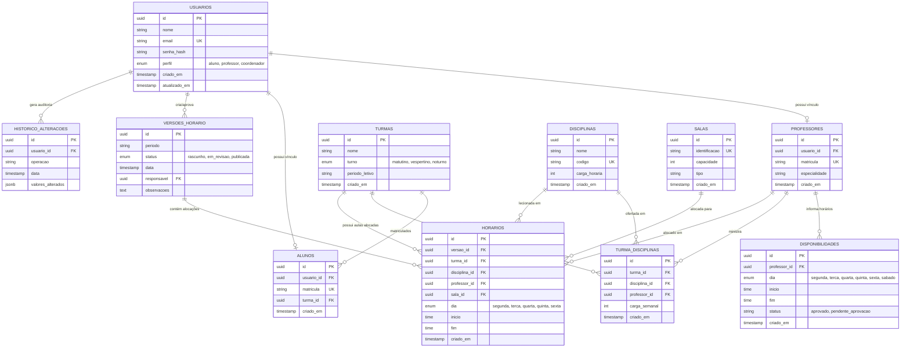

# Diagrama Entidade-Relacionamento (DER)
## SUCELSO TECH - Sistema Inteligente de Horários Escolares
**Universidade Senai Cimatec | Engenharia de Computação | Prof. Celso Barreto**

---

### 1. Diagrama DER em Mermaid

---

### 2. Dicionário de Dados e Relacionamentos

| Tabela | Chave Primária | Chaves Estrangeiras | Regras e Restrições |
| :--- | :--- | :--- | :--- |
| **`usuarios`** | `id` (UUID) | - | `email` único, perfis restritos aos enums: `aluno`, `professor`, `coordenador`. |
| **`professores`** | `id` (UUID) | `usuario_id` -> `usuarios.id` | `matricula` única. Deleção em cascata com usuário. |
| **`alunos`** | `id` (UUID) | `usuario_id` -> `usuarios.id`, `turma_id` -> `turmas.id` | `matricula` única. Aluno pertence a uma turma ativa. |
| **`disciplinas`** | `id` (UUID) | - | `codigo` único (ex: BD01, DW02). Carga horária > 0. |
| **`turmas`** | `id` (UUID) | - | Turno (matutino, vespertino, noturno) e período letivo. |
| **`salas`** | `id` (UUID) | - | `identificacao` única (ex: Lab 101), capacidade de alunos > 0. |
| **`disponibilidades`** | `id` (UUID) | `professor_id` -> `professores.id` | Intervalo temporal válido (`inicio < fim`). Dias da semana padronizados. |
| **`turma_disciplinas`** | `id` (UUID) | `turma_id`, `disciplina_id`, `professor_id` | Restrição única `(turma_id, disciplina_id)`. Define a carga horária semanal a cumprir. |
| **`versoes_horario`** | `id` (UUID) | `responsavel` -> `usuarios.id` | Estados: `rascunho`, `em_revisao`, `publicada`. Apenas a versão `publicada` é oficial para alunos e professores. |
| **`horarios`** | `id` (UUID) | `versao_id`, `turma_id`, `disciplina_id`, `professor_id`, `sala_id` | Alocação de slot de aula. Validação de sobreposição temporal de turma, professor e sala. |
| **`historico_alteracoes`** | `id` (UUID) | `usuario_id` -> `usuarios.id` | Log imutável em JSONB de todas as operações críticas (geração, ajuste de slot, publicação e atualização de disponibilidade). |

---

### 3. Integridade Referencial e Restrições de Conflito

1. **Restrição de Professor Unívoco**: Um professor não pode estar alocado em dois horários no mesmo dia e intervalo em uma mesma versão.
2. **Restrição de Sala Exclusiva**: Uma sala não pode conter mais de uma turma no mesmo dia e intervalo em uma mesma versão.
3. **Restrição de Turma Exclusiva**: Uma turma não pode ter mais de uma aula no mesmo horário.
4. **Disponibilidade Docente**: O horário alocado deve estar contido em pelo menos uma janela de disponibilidade ativa do professor.

