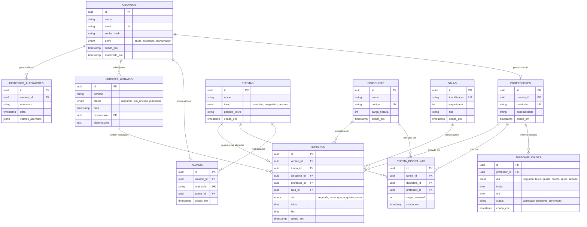

# Diagrama Entidade-Relacionamento (DER)
## SUCELSO TECH - Sistema Inteligente de Horários Escolares
**Universidade Senai Cimatec | Engenharia de Computação | Prof. Celso Barreto**

Este documento detalha o modelo de dados relacional implementado no PostgreSQL via Supabase para atender a todos os requisitos e regras da situação de aprendizagem.

